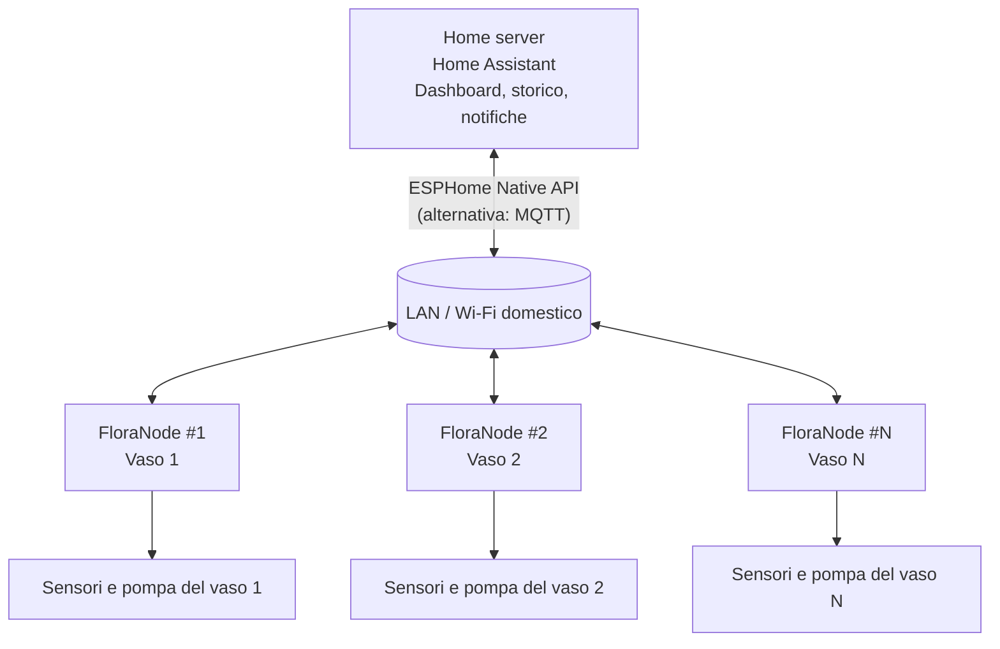
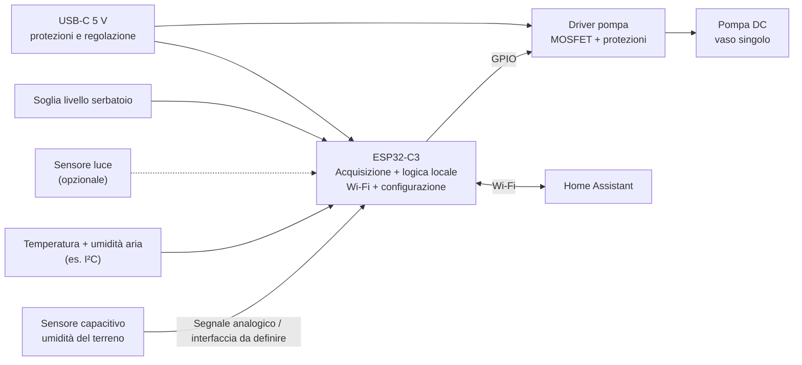
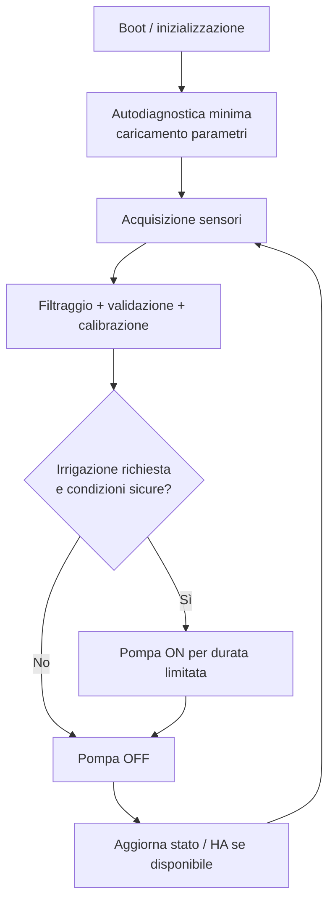

# FloraNode

**Smart Plant Monitoring & Automated Irrigation System**  
**Documento di concept e architettura preliminare — v0.1**  
**Data:** 8 novembre 2026  
**Stato:** idea / studio di fattibilità  
**Nome:** *FloraNode* è un nome di lavoro, non ancora verificato sul piano dei marchi.

> **Obiettivo del documento.** Raccogliere l'idea del prodotto, una prima ricognizione di soluzioni concorrenti e progetti open-source, un confronto sintetico e un'architettura di riferimento per avviare la prototipazione. Il documento non costituisce ancora una specifica hardware o software definitiva.

---

## 1. Idea del prodotto

### 1.1 Visione

**FloraNode** è un dispositivo IoT wireless, progettato a livello di elettronica, PCB, firmware e involucro, dedicato al **monitoraggio dello stato di una pianta e alla gestione locale dell'irrigazione**. Il sistema si integra con **Home Assistant**, installato su un home server, per visualizzare dati, configurare soglie, consultare lo storico e inviare comandi.

Il modello di riferimento è **un nodo per pianta/vaso**, replicabile: la gestione di base deve rimanere operativa sul microcontrollore anche se il server o la connessione Wi-Fi non sono disponibili. In questo modo Home Assistant è un supervisore e non un componente necessario per le protezioni e l'irrigazione automatica locale.

### 1.2 Funzioni previste

| Area | Funzione | Priorità proposta |
|---|---|---|
| Terreno | Misura capacitiva dell'umidità del suolo, con calibrazione per vaso/substrato | MVP |
| Ambiente | Temperatura e umidità relativa dell'aria | MVP |
| Irrigazione | Azionamento di una piccola pompa DC per il singolo vaso | MVP |
| Sicurezza | Rilevamento del serbatoio vuoto o sotto il minimo; blocco pompa | MVP |
| Automazione | Soglie, isteresi, tempo massimo pompa, intervallo minimo tra irrigazioni | MVP |
| Connettività | Wi-Fi verso Home Assistant | MVP |
| Interfaccia | Misure, allarmi, comando manuale e abilitazione/disabilitazione da Home Assistant | MVP |
| Luminosità | Misura dell'illuminamento ambientale | Evoluzione |
| Alimentazione | Batteria ricaricabile / eventuale supporto solare | Evoluzione |
| Diagnostica | Misura tensione batteria, corrente pompa, rilevamento guasti | Evoluzione |
| Gestione multi-nodo | Più FloraNode registrati in Home Assistant | Obiettivo di sistema |

**Confine funzionale:** il primo prototipo non deve stimare uno “stato di salute” botanico complessivo della pianta. Misura grandezze fisiche e applica regole configurabili; la relazione tra umidità letta e fabbisogno idrico richiede calibrazione e sperimentazione.

### 1.3 Proposta di valore e differenziazione

- **Approccio local-first:** monitoraggio e automazione utilizzabili sulla rete domestica, senza dipendenza da servizi cloud proprietari.
- **Autonomia funzionale:** il nodo decide e applica i limiti di sicurezza anche quando Home Assistant è offline.
- **Architettura modulare:** una revisione iniziale per un solo vaso, espandibile mediante più dispositivi uguali.
- **PCB custom documentato:** alimentazione, misura capacitiva, microcontrollore, driver pompa e connettori integrati in un progetto riproducibile.
- **Integrazione nativa nell'ecosistema domestico:** dashboard, notifiche, storico e scenari Home Assistant.
- **Sviluppo verificabile:** schematico, layout, BOM, firmware, procedure di calibrazione e test pubblicabili nel repository.

### 1.4 Ipotesi iniziali del prodotto

- **Unità per vaso**, con un canale di misura del terreno e una pompa; serbatoio locale o alimentazione idrica dedicata al vaso.
- **Microcontrollore candidato:** ESP32-C3, per Wi-Fi e disponibilità di ESPHome/ESP-IDF. Scelta da convalidare in base a pin, ADC, consumi, costo e disponibilità.
- **Prima alimentazione:** USB-C 5 V; batteria e solare sono lasciati a una revisione successiva per ridurre i rischi del primo prototipo.
- **Prima implementazione firmware:** ESPHome con logica locale; una successiva implementazione nativa in ESP-IDF è un'opzione se servono controllo, testabilità o consumi più sofisticati.
- **Protocollo verso Home Assistant:** preferenza iniziale per la **API nativa ESPHome**; **MQTT** come alternativa architetturale, non necessariamente contemporanea.

---

## 2. Ricerca online dei competitor e dei progetti di riferimento

### 2.1 Perimetro della ricerca

Sono state considerate due famiglie distinte:

1. **Prodotti commerciali** già rivolti agli utilizzatori: utili a valutare funzioni, integrazione e posizionamento.
2. **Progetti maker/open-source**: utili a studiare schemi, PCB, firmware, meccanica e scelte di architettura.

La ricerca è una **ricognizione tecnica preliminare**, non un'analisi esaustiva del mercato. Prezzi, disponibilità, condizioni delle licenze e caratteristiche di nuove revisioni andranno ricontrollati prima di avviare un prodotto commerciale.

### 2.2 Prodotti commerciali / riferimenti di mercato

**Apollo Automation — PLT-1 Plant Sensor**  
Sensore per piante orientato a Home Assistant/ESPHome. Misura umidità capacitiva del terreno, temperatura e umidità dell'aria, illuminamento e UV; disponibile con opzioni di alimentazione differenti. **Non include una pompa d'irrigazione integrata.** È un riferimento per un dispositivo di monitoraggio compatto e per l'esperienza di configurazione utente.  
Fonti: [Pagina del prodotto](https://apolloautomation.com/products/plt-1) · [ESPHome Devices](https://devices.esphome.io/devices/apollo-automation-plt-1/) · [GitHub](https://github.com/ApolloAutomation/PLT-1).

**OpenSprinkler**  
Controller commerciale e open-source per irrigazione a più zone, con gestione locale, programmi, supporto a sensori e integrazioni software. È focalizzato sull'**irrigazione multi-zona**, non su un piccolo nodo con sensore da inserire in ogni vaso. Rappresenta un riferimento per gestione degli attuatori, programmazione e affidabilità del controllo.  
Fonti: [Sito ufficiale](https://opensprinkler.com/product/opensprinkler/) · [Manuale firmware](https://opensprinkler.github.io/OpenSprinkler-Firmware/2.2.1/221_7_manual/).

### 2.3 Progetti open-source / DIY

**b-parasite — rbaron**  
PCB open hardware che integra un sensore **capacitivo di umidità del terreno**, temperatura/umidità ambientale e luminosità. Piattaforma nRF52 a basso consumo, con esempi firmware BLE, file KiCad e case. **Nessuna pompa integrata.** È il riferimento principale per geometria degli elettrodi, misura capacitiva, calibrazione e autonomia energetica.  
Fonte: [GitHub — rbaron/b-parasite](https://github.com/rbaron/b-parasite).

**Plantwatery — Lumics**  
Sistema ESP32 con sensore capacitivo, pompa, batteria/pannello solare, invio dati Wi-Fi via MQTT e contenitore stampato in 3D. Irriga autonomamente sulla base della misura del terreno. È un riferimento per consumi, deep sleep e gestione della pompa; l'invio MQTT non implica da solo un'integrazione Home Assistant già confezionata.  
Fonte: [GitHub — Lumics/Plantwatery](https://github.com/Lumics/Plantwatery).

**ESP32-C3 Plant Watering Controller — ginkel**  
PCB KiCad con ESP32-C3, **due uscite per pompe 12 V**, ingresso per rilevare un livello acqua basso e configurazione ESPHome compatibile con Home Assistant. **La misura dell'umidità del terreno non è integrata nel PCB**: l'autore la acquisisce tramite un altro sensore/dispositivo. È particolarmente utile per lo studio di alimentazione, potenza, BOM, Gerber e driver pompe.  
Fonte: [GitHub — ginkel/esp32-c3-irrigation-controller](https://github.com/ginkel/esp32-c3-irrigation-controller).

**Smart Plant — JGAguado**  
Scheda con elettronica da collocare in prossimità del vaso, misura dell'umidità del terreno, temperatura e illuminamento, visualizzazione e-paper e supporto ESPHome. **Non è un controller di irrigazione con pompa.** È utile per formato del nodo, PCB e modalità di presentazione dei dati.  
Fonti: [GitHub — JGAguado/Smart_Plant](https://github.com/JGAguado/Smart_Plant) · [ESPHome Devices](https://devices.esphome.io/devices/smart-plant/).

**OSUN Smart Plant Waterer — Lanrewaju2020**  
Prototipo ESP32 con sensore capacitivo, BME280, pompa, alimentazione a batteria, protezione per serbatoio basso, profili di pianta, dashboard web locale e involucro 3D. Usa una **carrier board** e diversi moduli: non è necessariamente un'integrazione monolitica su PCB. È il riferimento più vicino alla visione end-to-end di FloraNode.  
Fonte: [GitHub — osun-smart-plant-waterer](https://github.com/Lanrewaju2020/osun-smart-plant-waterer).

**PlantWatering — Meltwin**  
Progetto ESP32 con schematica KiCad, alimentazione USB-C e pilotaggio PWM di una pompa a 5 V tramite MOSFET. È soprattutto un riferimento per la **sezione di attuazione**; non va assunto che implementi tutte le funzioni di monitoraggio e integrazione previste da FloraNode.  
Fonte: [GitHub — Meltwin/PlantWatering](https://github.com/Meltwin/PlantWatering).

**Plant watering system — rubenwardy**  
Progetto DIY con **quattro sensori capacitivi, quattro pompe, serbatoio condiviso e PCB KiCad**. L'autore discute problemi di rumore introdotti dalle pompe e scelte di grounding. L'integrazione IoT/MQTT è descritta come possibile evoluzione, **non come funzione già implementata**. Utile per layout, driver, cablaggio e problemi EMC pratici.  
Fonte: [Articolo — Plant watering system: my first PCB](https://blog.rubenwardy.com/2025/11/17/plant-watering-first-pcb/).

**ESP32-based watering system — Elliot Mackinnon**  
Soluzione DIY con ESP32-S3/ESPHome, sensori capacitivi, sensore del livello e attuatori comandati da Home Assistant. La logica principale di irrigazione è **centralizzata su Home Assistant**, a differenza dell'autonomia locale desiderata per FloraNode. È utile come riferimento di integrazione, ma anche come caso per discutere la dipendenza dal supervisore.  
Fonte: [Articolo — ESP32-based watering system](https://emackinnon.io/projects/watering-system).

---

## 3. Tabella comparativa dei progetti simili

**Legenda:** ✓ funzione riportata dalla fonte; — funzione non indicata o non centrale nel progetto; *parziale* = ottenibile tramite integrazione o dispositivo esterno. La colonna PCB distingue un progetto con file PCB/schema disponibili da un semplice assemblaggio di moduli.

| Progetto | Categoria | Piattaforma | Umidità terreno | Irrigazione | Home Assistant / connessione | PCB / hardware | Cosa studiare |
|---|---|---|---|---|---|---|---|
| [b-parasite](https://github.com/rbaron/b-parasite) | Open-source | nRF52 | ✓ capacitiva | — | BLE; bridge/integrabilità | ✓ KiCad | Sensore capacitivo, BLE, consumi |
| [Plantwatery](https://github.com/Lumics/Plantwatery) | DIY | ESP32 | ✓ capacitiva | ✓ pompa | Wi-Fi/MQTT; HA da configurare | Cablaggi e case | Autonomia, solare, pompa |
| [ESP32-C3 Controller](https://github.com/ginkel/esp32-c3-irrigation-controller) | Open hardware | ESP32-C3 | *Esterna* | ✓ 2 pompe | ✓ ESPHome/HA | ✓ KiCad, BOM, Gerber | Driver, alimentazione, PCB |
| [Smart Plant](https://github.com/JGAguado/Smart_Plant) | Open-source | ESP32-S2 | ✓ | — | ✓ ESPHome | ✓ design board | Nodo compatto, e-paper |
| [OSUN](https://github.com/Lanrewaju2020/osun-smart-plant-waterer) | DIY | ESP32 | ✓ capacitiva | ✓ pompa | Dashboard locale Wi-Fi; HA non documentato | Carrier PCB e moduli | Prodotto completo, sicurezza, case |
| [PlantWatering](https://github.com/Meltwin/PlantWatering) | Open-source | ESP32 | — | ✓ pompa PWM | — | ✓ schematica KiCad | Attuatore, MOSFET, USB-C |
| [Ruben Wardy](https://blog.rubenwardy.com/2025/11/17/plant-watering-first-pcb/) | DIY | ESP32 | ✓ 4 sensori | ✓ 4 pompe | MQTT proposto, non implementato | ✓ PCB KiCad | Grounding, interfacce di potenza |
| [ESP32-based watering](https://emackinnon.io/projects/watering-system) | DIY | ESP32-S3 | ✓ | ✓ valvole/pompa | ✓ ESPHome e HA; logica su server | Moduli / collegamenti | Automazioni e dashboard |
| [Apollo PLT-1](https://apolloautomation.com/products/plt-1) | Commerciale | ESP32 / ESPHome | ✓ capacitiva | — | ✓ Home Assistant | Prodotto compatto | Sensori e UX d'integrazione |
| [OpenSprinkler](https://opensprinkler.com/product/opensprinkler/) | Commerciale/open-source | Controller dedicato | *Sensori secondo modello* | ✓ multi-zona | MQTT/API e integrazioni | ✓ hardware open-source | Programmazione, protezioni, multi-zona |

### 3.1 Valutazione sintetica

- **Più utile per il sensore:** b-parasite.
- **Più utile per il PCB di attuazione:** ginkel/esp32-c3-irrigation-controller.
- **Più vicino al concept completo:** OSUN.
- **Più utile per autonomia/batteria/solare:** Plantwatery.
- **Più utile per l'integrazione Home Assistant:** Apollo PLT-1 e l'impianto ESPHome di Elliot Mackinnon.
- **Più utile per analizzare problemi reali di PCB:** articolo di Ruben Wardy.

**Conclusione di posizionamento:** la funzionalità di base non è nuova. L'opportunità progettuale consiste nel combinare **misura capacitiva, controller per singolo vaso, logica locale affidabile, PCB personalizzato e integrazione Home Assistant**, mantenendo il dispositivo riproducibile e ben documentato. La differenziazione commerciale è un'ipotesi da validare con ulteriori ricerche e test.

---

## 4. Prima bozza dell'architettura

### 4.1 Vista di sistema

Il sistema è costituito da più nodi FloraNode autonomi connessi alla rete Wi-Fi domestica. Home Assistant sul server funge da punto di supervisione e configurazione.

**Requisito architetturale principale:** la perdita del collegamento con Home Assistant **non deve compromettere** il rispetto dei limiti e dei blocchi di sicurezza dell'irrigazione. La perdita di rete non può generare un comando involontario alla pompa.

### 4.2 Architettura hardware del singolo nodo

**Blocchi hardware candidati**

| Blocco | Scelte iniziali | Verifiche tecniche |
|---|---|---|
| MCU/radio | Modulo ESP32-C3 con antenna integrata | Pin disponibili, robustezza Wi-Fi, ADC, watchdog, consumi |
| Misura terreno | Elettrodi capacitivi su PCB oppure sensore esterno per V0 | Corrosione, isolamento, deriva, ripetibilità, ADC, calibrazione |
| T/RH ambiente | Sensore digitale su bus I²C | Self-heating, posizione lontana da condensa e sorgenti termiche |
| Livello acqua | Galleggiante/sensore di soglia | Gestione falsi contatti, sicurezza a serbatoio vuoto |
| Pompa | Micro-pompa DC a bassa tensione | Portata, spunto, rumore, consumo, vita utile, ritorno/sifonamento |
| Driver | MOSFET logic-level con dimensionamento adeguato | Corrente di spunto, transitori, protezione induttiva secondo tipo di pompa |
| Alimentazione | USB-C 5 V e regolatore 3,3 V | Picchi di corrente, brownout, protezioni ESD, layout power/ground |
| PCB | KiCad, zona umida separata dall'elettronica | Distanze, connettori, fissaggio, coating, test point |

**Nota di progetto:** il tipo di protezione contro i transitori dipende dalla pompa scelta (motore DC spazzolato, brushless con driver interno ecc.); non va adottato uno schema generico senza datasheet e misure. Sensore e attuatore devono essere caratterizzati anche in presenza dei disturbi di commutazione.

### 4.3 Architettura firmware

Approccio consigliato: **ESPHome per il primo prototipo**, mantenendo i controlli essenziali sul nodo. La API nativa ESPHome consente il collegamento a Home Assistant sulla LAN; MQTT resta una possibilità alternativa se è desiderata una maggiore separazione dal software Home Assistant.

**Funzioni firmware di base**

1. Acquisizione periodica delle misure, controllo del range e gestione dei valori invalidi.
2. Conversione e calibrazione dell'umidità del terreno; memorizzazione locale dei parametri persistenti.
3. Decisione locale in base a soglie configurabili, isteresi e tempi minimi tra irrigazioni.
4. Limite rigido al tempo massimo di attivazione di ciascun ciclo e alla quantità/tempo giornaliero cumulato.
5. Inibizione pompa in caso di serbatoio sotto soglia, dato sensore invalido, errore critico o disabilitazione manuale.
6. Stato pompa **OFF di default** al boot, reset e in caso di errore; watchdog e comportamento fail-safe da verificare.
7. Esposizione verso Home Assistant di sensori, allarmi, comando manuale controllato, soglie e abilitazione automazione.
8. Registrazione di diagnostica minima: ultima irrigazione, causa dell'attivazione, errore eventuale.

**Attenzione:** la logica di irrigazione non si riduce a un confronto istantaneo con una soglia; il sensore può essere rumoroso e il valore dipende dal substrato. Definire una procedura di calibrazione e verificare il ritardo con cui l'acqua raggiunge il sensore dopo l'irrigazione.

### 4.4 Interfaccia Home Assistant

**Entità suggerite per ogni FloraNode:**

- `soil_moisture` — umidità relativa del terreno (%) **solo se calibrata**; altrimenti valore raw/normalizzato esplicitamente etichettato.
- `air_temperature` — temperatura ambiente (°C).
- `air_humidity` — umidità relativa dell'aria (%).
- `reservoir_low` — allarme livello minimo.
- `pump_state` — stato della pompa.
- `watering_enabled` — abilitazione automatismo.
- `watering_now` — richiesta manuale **soggetta agli stessi interblocchi di sicurezza**.
- `soil_threshold` — soglia configurabile.
- `last_watering` / `watering_duration` — storico sintetico dell'attuazione.

L'eventuale **dashboard multi-pianta** dovrebbe mostrare a colpo d'occhio umidità del terreno, disponibilità acqua, stato collegamento e data dell'ultima irrigazione.

### 4.5 Sequenza di sviluppo proposta

| Fase | Risultato atteso | Criterio minimo di chiusura |
|---|---|---|
| **P0 — Proof of concept** | ESP32 dev board + sensore umidità + pompa + livello acqua | Letture coerenti; comando pompa sicuro in banco |
| **P1 — Integrazione locale** | ESPHome / Home Assistant e controllo locale | Continua a rispettare blocchi e limiti senza server |
| **P2 — PCB Rev.A** | Sch, layout, BOM, fabbricazione e assemblaggio | Power-up, comunicazione, ADC, attuatore e protezioni collaudati |
| **P3 — Involucro** | Custodia 3D e interfacce col serbatoio | Nessun contatto incontrollato tra liquidi ed elettronica |
| **P4 — Validazione su pianta** | Calibrazione, test su substrati diversi e test di lunga durata | Comportamento stabile, nessuna irrigazione incontrollata |
| **P5 — Miglioramenti** | Batteria, luminosità, diagnostica, eventuale ESP-IDF | Specifiche definite sulla base dei dati sperimentali |

### 4.6 Questioni aperte da decidere prima dello schematico

- **Sensore terreno:** progettare elettrodi capacitivi sul PCB del nodo oppure prevedere una sonda esterna sostituibile?
- **Architettura meccanica:** elettronica sul vaso e serbatoio esterno, oppure modulo integrato con serbatoio?
- **Pompa e tensione nominale:** scegliere un modello specifico prima di dimensionare MOSFET, protezioni e power stage.
- **Alimentazione:** USB-C continua per V1 oppure requisito immediato di funzionamento a batteria?
- **Strategia software:** ESPHome dichiarativo con automazioni locali oppure firmware ESP-IDF dedicato?
- **Obiettivi misurabili:** durata di vita, consumo, precisione/risoluzione utile, volume erogato, costo BOM e dimensioni.
- **Sicurezza idraulica:** rischio di sifonamento, perdite, tubo scollegato, pompa a secco e durata massima di erogazione.

---

## Fonti principali e data di verifica

Ricognizione effettuata l'**8 novembre 2026**, usando prevalentemente repository originali, pagine dei produttori e documentazione di progetto. La presenza di un repository non equivale a una verifica indipendente delle prestazioni riportate dall'autore.

1. [rbaron/b-parasite](https://github.com/rbaron/b-parasite)
2. [Lumics/Plantwatery](https://github.com/Lumics/Plantwatery)
3. [ginkel/esp32-c3-irrigation-controller](https://github.com/ginkel/esp32-c3-irrigation-controller)
4. [JGAguado/Smart_Plant](https://github.com/JGAguado/Smart_Plant)
5. [Lanrewaju2020/osun-smart-plant-waterer](https://github.com/Lanrewaju2020/osun-smart-plant-waterer)
6. [Meltwin/PlantWatering](https://github.com/Meltwin/PlantWatering)
7. [Ruben Wardy — Plant watering system](https://blog.rubenwardy.com/2025/11/17/plant-watering-first-pcb/)
8. [Elliot Mackinnon — ESP32-based watering system](https://emackinnon.io/projects/watering-system)
9. [Apollo Automation — PLT-1](https://apolloautomation.com/products/plt-1)
10. [OpenSprinkler](https://opensprinkler.com/product/opensprinkler/)
11. [ESPHome — Native API](https://esphome.io/components/api/)

**Nota legale:** prima di utilizzare FloraNode come marchio o nome commerciale è necessaria una verifica separata dei marchi e delle denominazioni simili. Per riutilizzare hardware o codice dei progetti citati, leggere e rispettare le rispettive licenze.
